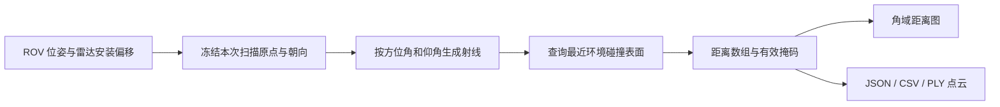

# ROV 移动、密集障碍与几何雷达使用验收指南

适用场景：`Assets/Underwater/Scenes/UnderwaterRadarSurveyEditable.unity`。更新：2026-10-27。

## 1. 当前场景与操作定义

自然区仍为 80 × 50 m、深 10 m。恢复加密前 60 块礁石的随机水平位置，压低竖向尺度并重新贴合地面；本轮新增的管道、圆环、管拱、系泊环全部从两区移除。

右摇杆移动当前区 ROV；左摇杆移动观察者；X 切区；右 Grip + 位姿控腕；手套控 WA100 手指。雷达用左 Grip 单独松开启停。左 Grip + Y 只切任务面板，不触发雷达或气泡。三路相机、腕部测距与抓取任务见 [抓取任务与多视角操作指南](抓取任务与多视角操作指南.md)。

## 2. 固定按键

完整定义、冲突原因和逐项核对步骤见 [当前按键定义](当前按键定义.md)。

| 雷达动作 | PICO | 桌面 |
|---|---|---|
| 开始 / 停止 | 左 Grip 单独按后松开 | F7 / Start / Stop |
| 选择预设 | 不占用其他手柄键 | F10 / 预设按钮 |
| 调整俯仰 | 不占用其他手柄键 | [ / ] / 滑条 |
| 自动俯仰 | 不占用其他手柄键 | F8 |
| 导出完整帧 | 不占用其他手柄键 | F9 / Export 3 files |
| 显示 / 隐藏雷达图带 | 不占用其他手柄键 | F6 |
| 显示 / 隐藏整个任务面板 | 左 Grip + Y，组合优先 | F1 |
| 前视 / 腕部向下测量 | 不占用其他手柄键 | F11 / Radar settings 模式按钮 |

参数可由电脑在 Live Preview 运行时调整。A 切灯、B 切尾流、单独 Y 松开发气泡，左摇杆按下切性能档；握住左 Grip 后按 Y 会切面板并取消单键动作。雷达父对象关闭后单独左 Grip 为空操作，面板和摄像头仍可用。

## 3. 雷达到底测什么

本项目里的“雷达”是理想几何测距器：从安装在 ROV 前方的一个测量原点，向前视扇区中的许多方向发射数学射线，查询每条射线最先碰到的环境碰撞表面，返回以米为单位的距离。

它借鉴论文的前视安装、俯仰扫描、距离数组与点云流程。这里没有模拟电磁波在水里的传播、反射强度、频率衰减、噪声、多径或 Doppler，所以结果用于几何扫描、障碍检测和后续算法验证，不能据此推断真实水下雷达硬件的探测能力。



每次扫描冻结传感器位姿，分若干渲染帧计算，默认每帧最多 256 条射线。这样减少单帧负担；一张扫描图不是在同一个渲染帧中立刻生成。目标更新上限为 5 Hz，实际完整扫描率还受采样数、分帧预算与渲染速度影响。测精确距离时应先松开 ROV 摇杆，等扫描帧编号再更新至少一次。

同一条射线上如果近处有礁石，它就会遮住后面的管线；不会穿透礁石去报告后面的物体。自身 ROV 的碰撞体被排除，环境 Layer 8 上的非 Trigger 碰撞体参与测距。礁石与新制造物使用实际显示网格对应的 MeshCollider，所以测量轮廓与可见表面一致。

雷达安装轴经过修正，初始前方为场景 +Z，安装偏移为 ROV 根位置加米制 `(0, 1.2, 2)`。雷达不在人的眼睛或右手柄上；“从哪里测”应看雷达的安装原点，而不是目测眼睛到礁石的距离。导入模型根比例是 0.002，传感器单独保持米制，避免测量尺度被模型比例缩小。

## 4. 怎么读这张图

它是**方位角 × 仰角的距离图**，不是相机照片、俯视地图或回波强度图。

当前紧凑面板仅常驻距离图、中央束（C）、RUN/STOP、帧号（#）和抓取状态；下表 Nearest、Hits、CPU 及完整扫描状态在电脑展开 Radar settings 后查看。

| 面板内容 | 含义 | 正确理解 |
|---|---|---|
| 图像水平方向 | 从扫描器左侧到右侧的方位角 | 左边像素对应 ROV 雷达左侧的射线 |
| 图像竖直方向 | 从低到高的仰角 | 上方像素对应向上的射线 |
| 橙黄色 | 同一量程内相对较近的有效表面 | 不是“反射更强” |
| 蓝色 | 同一量程内相对较远的有效表面 | 切换量程后同一距离的颜色也可能变化 |
| 暗色 | 没有有效测距 | 可能为空、超量程或最近障碍处于盲区，不能直接当成零距离 |
| Centre | 中央方位、中央仰角的距离，单位 m | 只是一束正中心射线，不是整幅图的平均距离 |
| Nearest | 所有有效射线中最小的距离 | 倾斜向下时可能先测到地面，比 Centre 小很正常 |
| Hits | 当前完整帧的有效命中数 | 它反映可见几何覆盖程度，不是正确率 |
| Frame / RUN / STOP | 帧更新与扫描状态 | RUN 时 Frame 持续增加；STOP 时保留最后完成图像 |
| CPU | 一次完整扫描累计的 CPU 查询耗时 | 不等于整个游戏帧时间，也不能直接换算成头显总 FPS |

默认 Near structure 为 121 列 × 9 行，整帧有 1,089 个方向。稀疏的九行会呈现条带或块状轮廓；这来自角度采样分辨率。想看高差与竖向结构时选 Vertical wall，而不是只调颜色让它“看起来像雷达”。

## 5. 选择哪个预设

| 预设 | 量程 | 水平方位 × 垂直仰角范围 | 列 × 行 | 推荐使用 |
|---|---:|---:|---:|---|
| Near structure | 15 m | 90° × 20° | 121 × 9 | 第一次上手、ROV 周围障碍 |
| Wide survey | 30 m | 120° × 30° | 161 × 13 | 较大范围的海床巡检 |
| Long corridor | 60 m | 60° × 12° | 121 × 7 | 前方较远、较窄的目标范围 |
| Vertical wall | 25 m | 70° × 60° | 101 × 21 | 地形坡面与垂直表面 |
| Grasp close | 2 m | 90° × 60° | 81 × 21 | 腕部向下观察地面和抓取目标 |

这些是自定义仿真参数，不能当成真实雷达型号。启动前可以选好预设，扫描中也可以切换；切换会丢弃未完成帧和旧结果，等待新参数下的一整帧完成后再读数。

## 6. 正确上手流程

1. 打开本指南开头的新场景，确认 Hierarchy 中 `GeometryRadar_System` 已勾选启用，然后进入 Play。
2. 先在水池练习。电脑展开 Radar settings，选择 Near structure；左 Grip 单独按后松开启动扫描。看面板变成 RUN，距离图更新。F11 可切回前视模式后做 5 m 校验。
3. 不碰摇杆，先观察 Centre、Nearest 和图像。视线转向时，三维场景应保持在世界中；雷达仪表跟随头部，扫描器仍跟随 ROV。
4. 轻推右摇杆。应看到 ROV 和其机械臂整体水平移动，观察者的位置不因此移动。松开摇杆后 ROV 停止；遇到障碍，主体包围盒、WA100 与 Axis1p 整臂保护会阻挡继续压入，并尝试请求右手柄短震。先移开机械臂或反向退出，再继续移动。它是巡检平移控制，不是推进器六自由度水动力驾驶。
5. ROV 靠近正前方目标时，等待下一完整扫描帧后，相应目标距离应减小；后退时增大。先选固定宽面目标，不要一开始对着礁石尖端或边缘做一一数值比较，因为稍微横移就可能换成另一表面。
6. 在电脑用 [ / ] 或面板滑条调整俯仰。向下时地面通常占据更多有效命中；向上时较高地形和结构进入扫描，地面命中通常减少。人的视线转向并不代替雷达俯仰。
7. 切换 Vertical wall，固定 ROV 位置，按几个不同俯仰角分别扫描和导出。用相同量程比较轮廓，用数值比较距离；跨预设不要只比较颜色。
8. 电脑 F9 导出已完成帧。最后单按左 Grip 停止，或者退出 Play。

## 7. 最容易判断对错的 5 米校验

电脑 Unity Play + PICO Live Preview 下，电脑的 Game 窗口也显示雷达控制面板。可以先在电脑完成这次校验，再佩戴头显练习按键。

1. 停止 ROV 移动，确认前视模式（FRONT）。选择 Near structure，俯仰设成 0°，关闭 F8 自动俯仰。
2. 点击 Game 雷达面板的 **Place 5 m check target**。这会把一块 2.4 × 2.4 m、厚 0.12 m 的平面校验靶放在当前雷达前方，让**靶板前表面**距雷达测量原点恰好 5 m。按钮只放靶，不会开启扫描，也不会清除其他障碍。
3. 开始扫描，并在 ROV 不动时等下一帧完成。无遮挡时，**Centre 应约为 5.00 m**。用 ±0.03 m 作为这一简单演示的检查容差。
4. 如果 Centre 小于 5 m，先检查中央射线上是否有近处礁石或地形：最近物体遮住靶板时，报告更近的物体才是正确结果。放靶时面板会预检查，并可能提示 `OCCLUDED: nearer obstacle at … m`；这是放靶时刻的检查，移动后应以新完整帧为准。不要把 Nearest 必须等于 5 m 作为条件，它可能来自向下的地面射线。
5. 保持靶板不动，让 ROV 沿雷达前方靠近 0.5 m，停稳并等完整帧；中央束还落在靶板上且无遮挡时，Centre 应约为 4.5 m。后退 0.5 m，应恢复约 5.0 m。可以通过 Inspector 看 ROV 世界 Z 位移核对，不要用观察者/头部位移代替 ROV 位移。
6. 测量期间**不要再次点击 Place**。再次点击会把靶重新放到新的雷达原点前 5 m，这时读数恢复 5 m 是重新放靶的结果。
7. 测完点击 **Hide check target**，避免把临时靶误当成场景障碍。它也会随整个雷达模块一起禁用。

非零俯仰时，也可沿中央射线放置 5 m 靶，但此时 ROV 只做水平运动，不能再简单用水平前进 0.5 m 推断测距减少正好 0.5 m。因此初学者先用 0° 做定量检查。

## 8. 什么成果才算正确

| 实验 | 应得到的结果 | 不应据此下的结论 |
|---|---|---|
| 静止 ROV 扫描静止靶 | 连续完整帧的距离基本稳定；Frame 更新 | 不代表真实传感器噪声已经复现 |
| 中央无遮挡 5 m 靶 | Centre 约 5.00 m | Nearest 不必也是 5 m |
| 沿雷达前方靠近固定平面 | 距离变化与实际沿射线方向的位移一致 | 横向绕过礁石尖端时读数无需线性变化 |
| 近物遮挡远物 | 相同射线返回近物，远物不出现 | 不能看到“穿透岩石”的远处点 |
| 下倾扫描海床 | 较多低处/地面命中，距离随坡面变化 | 命中多不等于精度更高 |
| 扫描不规则礁石 | 点云贴合可见岩石表面 | 不应变成外包长方体表面 |
| 停止扫描 | Frame 冻结，最后一帧可导出 | STOP 后保留旧图不等于仍在计算 |
| 禁用模块 | 雷达图隐藏、没有新帧，ROS 事件停止；相机与 ROV 仍可用 | 不需要把 ROV 一起停用 |

建议组会成果至少有四类：①加密海床全景/近景图，说明 ROV 周围障碍分布；②固定靶的已知距离与测量距离对照表；③同一位置在 0°、−15°、+15° 的角域距离图和点云；④一次导出 JSON/CSV/PLY 的对应说明。不要把距离伪彩图直接称为真实雷达回波图。

可使用下面的记录表：

| 场景/目标 | 预设/俯仰 | 靶真值或沿束位移 | Centre 测距 | 绝对误差 | 帧编号 | 是否遮挡 |
|---|---|---:|---:|---:|---:|---|
| 固定平面靶 | Near / 0° | 5.00 m | 实测填写 | `abs(测量−真值)` | 导出 sequence | 否 |
| 同靶，前进 0.50 m | Near / 0° | 4.50 m | 实测填写 | 同上 | 同上 | 否 |
| 同靶，后退恢复 | Near / 0° | 5.00 m | 实测填写 | 同上 | 同上 | 否 |

## 9. 导出文件和数据检查

当前 Windows 工程的导出目录通常是：

`C:\Users\ASUS\AppData\LocalLow\DefaultCompany\My project\GeometryRadar`

运行时 Console 会打印这次实际导出路径。每次成功导出同一个扫描帧的三个文件：

| 文件 | 内容 | 常用检查 |
|---|---|---|
| `radar-时间-帧号.json` | 元数据、冻结原点/姿态、ranges、hits、points | 所有数组长度等于 columns × rows；用 hits 过滤有效测量 |
| 同名 `.csv` | 每条射线的行列、角度、有效位、距离和局部点坐标 | Near 预设应有 1,089 条数据行，加 1 行表头，共 1,090 行 |
| 同名 `-local-FLU.ply` | 仅有效命中的点云 | 顶点数应等于 JSON 中 true 的 hits 数，可在 CloudCompare 等软件打开 |

无有效命中：`hits=false`、`ranges=-1`；零 points 只是占位，不是测到原点。不能把这些无效点也画进点云。有效点坐标的长度应近似等于该射线的距离。

PLY 和 points 使用雷达**局部 FLU**：X 前、Y 左、Z 上，单位 m。JSON 的 origin/rotation 仍是 Unity 世界坐标，time 是 Unity 仿真时间。单帧 PLY 不包含把多帧自动配准成地图的流程；不同 ROV 位置的局部点云不能直接叠加当世界地图。

如果需要还原某点到 Unity 世界：设局部 FLU 点为 `(f,l,u)`，先转换为 Unity 雷达局部 `(-l,u,f)`，然后计算 `origin + rotation * localPoint`。必须使用**该导出帧**里的 origin/rotation，不能拿当前手柄或当前头部位姿转换。

## 10. 不用时怎样整体关闭

Hierarchy：

```text
GeometryRadar_System                       ← 取消这里的 Active 勾选
├─ Pool Ideal Geometry Radar                ← 水池扫描器 + ROS 接口
│  └─ Geometry Radar Display                ← 旧独立仪表，本场景由任务面板取代
├─ Seabed Ideal Geometry Radar              ← 自然区扫描器 + ROS 接口
│  └─ Geometry Radar Display                ← 旧独立仪表默认停用
└─ CalibrationTarget_5m ...                 ← 默认隐藏的校验靶

ROVp - Pool                                ← 含独立 ROV 移动组件
ROVp - Seabed                              ← 含独立 ROV 移动组件
Generated Survey Reefs - random low layout       ← 可手调的礁石与自然区障碍
```

取消父对象的 Active 会停扫描、隐藏雷达图带并停止其 ROS 事件。任务面板会显示 Radar module OFF，三路相机和抓取继续可用。重新启用时需重新按 Start；不会偷偷恢复扫描。只取消扫描器组件的 Enabled 也能停止该扫描器，但要连 ROS 组件也一起关闭，使用整个父对象最明确。

只想临时减小遮挡可以 F1 / Grip + Y 隐藏整个任务面板（停止额外相机预览），或 F6 只隐藏雷达图带；扫描仍可能运行。手调障碍后重新进入 Play 会重建流场遮罩；大范围修改完可用菜单 `19 Bake Expanded Seabed Water Reflection` 更新静态反射。

## 11. 本轮验证与范围

实际 Unity Editor 已执行：场景/Shader 导入检查、射线最近命中与盲区遮挡、ROV 碰撞阻挡、固定按键、长按去重和同时按键互不改义、5 m 靶测距、三种格式导出及行数/有效点数核对、父对象禁用后的扫描与仪表停用，以及两区 Play 运行。确切结果在同目录 `UNDERWATER_RADAR_VALIDATION.json`。

本轮无遮挡固定靶实际结果：5.000 m；沿前向靠近 0.260 m 后为 4.740 m，与几何真值一致。单次两区 Play 没有捕获 Error/Exception，ROV 移动与接触阻挡的最新结果见验证 JSON。它是脚本驱动的 Editor 检查，不能替代手柄实际操作验证。


这些检查证明本地几何与软件链路可以运行。PICO 固定按键的真实设备识别、佩戴时的仪表可读性和长期帧率仍需实际佩戴确认。ROS 当前只有预留接口，没有打开网络连接；也没有新增真实电磁传播或经过标定的六自由度 ROV 推进器控制。
